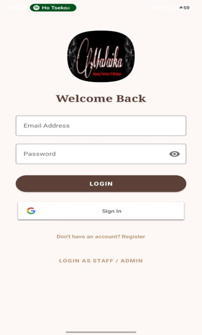
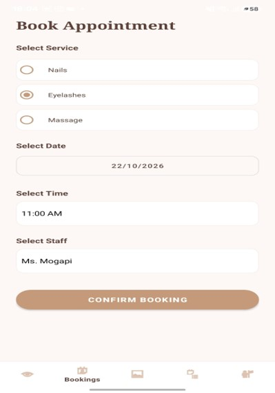
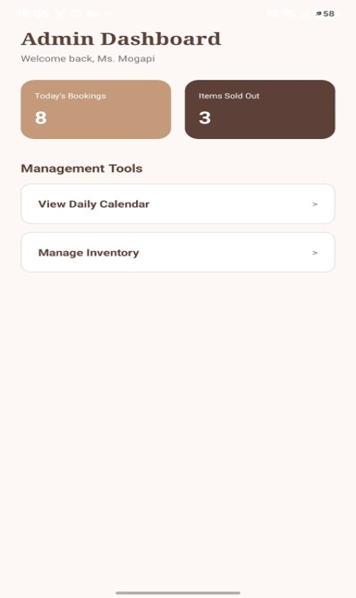
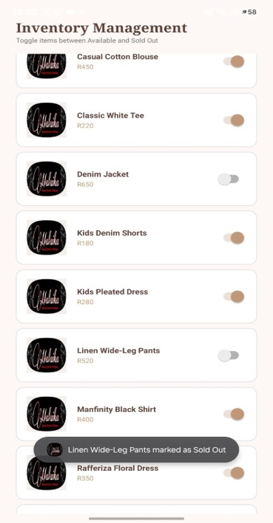

Malaika Beauty Parlor & Boutique App
Module: XISD6329 - WIL 3B  
Developed by: OGA Corp (Gomolemo Mokoma, Obakeng Makgae, Anathi Mphela)

 Project Overview
The Malaika app is a dual-platform Android application designed to modernize the business operations of Malaika Beauty Parlor & Boutique.
It features a premium client-facing interface for booking beauty services and shopping a curated clothing catalogue, alongside a dedicated
Staff/Admin dashboard for managing daily operations.

Key Features
Client App: Secure Login/Registration (Email & Google SSO), Browse Clothing (Women/Men/Kids), Wishlist, Book Appointments 
(Date/Time/Staff selection).
Staff Dashboard: Role-based access, View Daily Calendar, Manage Inventory (Toggle Available/Sold Out).

Design Considerations
The application utilizes a premium Material Design 3 layout. To match the Malaika brand identity, we implemented a custom color palette
consisting of soft beige backgrounds, warm taupe accents, and dark brown typography.

 DevOps & GitHub Actions
This project implements Continuous Integration (CI) using GitHub Actions. Every time code is pushed to the `main` branch, an automated
workflow builds the Android application and runs Espresso UI tests to ensure no new code breaks existing functionality.

Demo Video
A full demonstration of the app running on a physical Android device, including a voice-over and Firebase backend proof, can be viewed
here:
 Watch the Demo Video on YouTube
https://www.youtube.com/shorts/fwSbJXzmZmY
Screenshots

Splash Screen
### Splash Screen

Login
### Login

Home
### Home

Boutique
### Boutique

Booking System
### Booking System

Admin Dashboard
### Admin Dashboard

Inventory
### Admin Inventory

Installation
The signed APK is ready for deployment. To test the app, download the APK file and install it on an Android device
(ensure "Install from Unknown Sources" is enabled).
